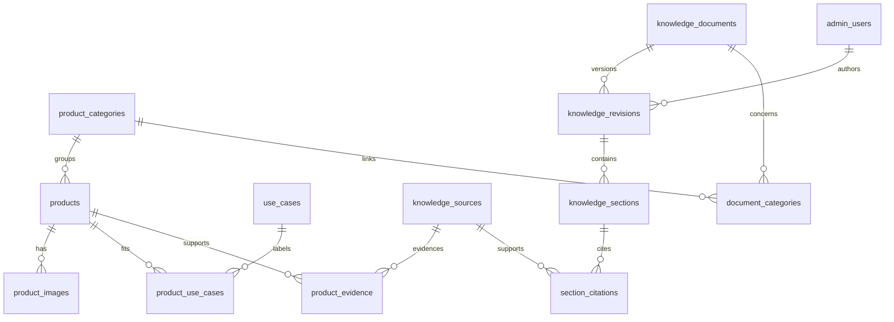

# Mô hình dữ liệu Trầm Hương — phiên bản 1

## Phạm vi và trạng thái

Đây là thiết kế để bắt đầu database và quản trị cho website tư vấn trầm hương có dẫn nguồn. Chưa tạo database trên cloud, chưa tạo tài khoản, chưa nối website hoặc thay `js/catalog.js`. Chưa có API, màn hình quản trị, xác thực hoặc AI mới. SQL được kiểm tra với SQLite cục bộ trong bộ nhớ; cần thử môi trường D1 trước triển khai.

Thiết kế giữ HTML/JavaScript và Cloudflare Pages Functions đang có. SQL dùng kiểu SQLite để có thể đi tiếp với D1. Migration nằm trong `migrations/`, không phải mã chạy trên trình duyệt. Không đưa migration, dữ liệu nội bộ và tests vào thư mục output tĩnh khi cấu hình deployment sau này.

## 1. Phân biệt nhóm trầm và sản phẩm

Sáu mục hiện tại trong catalog là các **nhóm giới thiệu**, chưa phải sáu SKU đã có giá và quy cách xác nhận. Chúng được seed vào `product_categories`, giữ nguyên ID/slug cũ. Chưa nhập các mô tả có khẳng định chưa kiểm chứng vào kho AI.

`products` là từng mẫu hàng cụ thể mà cửa hàng xác nhận. Một sản phẩm thuộc một nhóm; cùng nhóm có thể có nhiều sản phẩm. Bản đầu chưa có biến thể: nếu quy cách/giá khác nhau thì dùng SKU riêng. Tồn kho chỉ có trạng thái cung cấp, chưa quản lý số lượng hay đơn hàng.

Không bịa giá, trọng lượng, nguồn gốc hoặc chứng nhận để điền đủ bảng. `NULL` là chưa biết/không áp dụng; `0` VND là giá miễn phí, không phải chưa có giá. Mặc định `price_mode=contact`, `price_vnd=NULL`, `availability=unknown`, `status=draft`.

## 2. Các bảng và trường chính

| Bảng | Vai trò / trường chính |
|---|---|
| `admin_users` | `auth_subject` định danh từ hệ thống đăng nhập; `display_name`, `role`, `is_active`. Không lưu mật khẩu trong schema này. |
| `product_categories` | Nhóm trầm: ID cũ, slug, tên Việt/Anh, mô tả, thứ tự và trạng thái. |
| `products` | SKU, slug, category, tên/mô tả Việt/Anh, quy cách, bảo quản, trọng lượng gram, kích thước mm dạng mô tả, số hạt, giá VND nguyên, trạng thái cung cấp, phiên bản cập nhật. |
| `product_images` | Một sản phẩm nhiều ảnh: đường dẫn lưu trữ, alt Việt/Anh, thứ tự; tối đa một ảnh chính. Ảnh thực nằm trong assets hoặc object storage. |
| `use_cases` | Từ vựng bộ lọc nhu cầu: cá nhân, quà tặng, xông hương. |
| `product_use_cases` | Quan hệ nhiều-nhiều; có lý do phù hợp cụ thể, không chỉ gắn nhãn tùy ý. |
| `knowledge_sources` | Nguồn: loại, tiêu đề, tác giả/đơn vị, URL hoặc mã tài liệu nội bộ, ngày công bố/truy cập, ghi chú quyền sử dụng, trạng thái kiểm duyệt và quyền công khai. |
| `product_evidence` | Mỗi khẳng định về mẫu hàng gắn nguồn, vị trí trong nguồn và đoạn đối chiếu; có trạng thái/người duyệt. |
| `knowledge_documents` | Bài/FAQ: slug, chủ đề, quyền công khai, trạng thái lưu trữ. |
| `knowledge_revisions` | Phiên bản bài theo ngôn ngữ: số phiên bản, tiêu đề, tóm tắt, tác giả, trạng thái, người/ngày duyệt và nhận xét. |
| `knowledge_sections` | Các đoạn có tiêu đề, nội dung và thứ tự; đây là đơn vị truy xuất/trích dẫn cho AI sau này. |
| `section_citations` | Mỗi đoạn gắn một hoặc nhiều nguồn, vị trí trang/mục và trích đoạn hỗ trợ. |
| `document_categories` | Một bài có thể liên quan nhiều nhóm trầm. Bài chung không cần liên kết nhóm. |

Các ID mới do backend tạo bằng UUID, không dùng tên hiển thị làm khóa. Slug ổn định để dùng URL; SKU ổn định cho nghiệp vụ. `updated_at`, `version`, `updated_by` do backend cập nhật trong cùng thao tác ghi. Không có trigger tự cập nhật thời gian. Ngày dùng ISO, thời gian dùng UTC. Trường Anh trống thì giao diện fallback Việt và thể hiện đúng ngôn ngữ; chưa tự động dịch nội dung chuyên môn.

## 3. Sơ đồ quan hệ

## 4. Điều kiện quản trị và công khai

### Sản phẩm

Luồng `draft → published → archived`. Backend chỉ công khai khi: nhóm đang công khai; có tên, SKU, mô tả, quy cách phù hợp và ít nhất một ảnh chính; giá nhất quán; thông tin kiểm chứng có bằng chứng đã duyệt từ nguồn đang được duyệt. Khi chưa có bằng chứng cho đặc tính cụ thể thì bỏ khẳng định hoặc để nháp, không dựa vào AI để điền.

SQL kiểm tra khóa, giá, enum và tối đa một ảnh chính. **Điều kiện xuất bản sản phẩm phải được triển khai tại API**, chưa có trigger thực thi toàn bộ các điều kiện trên. Sửa sản phẩm đang công khai phải chuyển về nháp trước để duyệt lại. Bản đầu không lưu lịch sử đầy đủ của sản phẩm; cần bổ sung bảng phiên bản/audit nếu rubric yêu cầu.

### Nguồn và kiến thức

Nguồn bắt đầu `pending`; reviewer kiểm tra tính phù hợp và quyền sử dụng rồi duyệt. URL không đồng nghĩa nguồn đáng tin. Tài liệu nội bộ giữ `visibility=internal` mặc định, không đưa vào câu trả lời công khai. Nếu cho phép công khai thông tin từ phỏng vấn/hồ sơ cửa hàng, cần tạo bản trích đã được đồng ý công khai, không xuất tài liệu riêng tư.

Bài có phiên bản `draft → in_review → approved` hoặc `rejected`; bản đã duyệt có thể `retired`. Chỉnh bài đã duyệt phải tạo phiên bản mới, sao chép các đoạn/trích dẫn rồi chỉnh bản mới; không cập nhật/xóa nội dung bản đã duyệt. Việc bất biến và chuyển trạng thái hợp lệ được **API** kiểm soát, SQL hiện chưa chặn mọi chỉnh sửa trực tiếp.

Trigger SQL bắt đầu mọi phiên bản ở `draft`, chặn duyệt khi chưa có đoạn hoặc có đoạn thiếu nguồn công khai đã duyệt. Trường reviewer/ngày duyệt bắt buộc khi duyệt. Điều này kiểm tra cấu trúc, không xác minh nguồn thực sự hỗ trợ nội dung; reviewer phải đọc và xác nhận.

View `published_knowledge_sections` chỉ lấy bài công khai chưa lưu trữ, bản approved mới nhất của từng ngôn ngữ, với mọi đoạn có ít nhất một nguồn công khai còn approved. Bản draft mới không che bản approved cũ. Rút nguồn có thể làm cả bản bài biến mất khỏi truy xuất; không tự fallback về phiên bản cũ. Khi xuất dẫn nguồn, API cũng chỉ lấy citations với nguồn public/approved.

Nguồn đã được dùng trong bài approved không sửa nội dung/chứng cứ trực tiếp: tạo nguồn mới và bản bài mới; có thể chuyển nguồn cũ sang retired để thu hồi. Điều kiện này phải kiểm tra tại API. Không dùng hard delete cho dữ liệu đã tham gia duyệt; khóa ngoại RESTRICT ngăn xóa nguồn đang được tham chiếu, archive/retire là thao tác thông thường.

### Quyền

| Vai trò | Quyền đề xuất |
|---|---|
| editor | Tạo/sửa bản nháp sản phẩm, nguồn, bài; gửi duyệt. Không tự công khai. |
| reviewer | Kiểm tra nguồn, bằng chứng, bài và xuất bản nội dung; tránh tự duyệt bài mình viết. |
| admin | Quản lý tài khoản, vai trò và toàn bộ nội dung; nếu chỉ một người phải ghi rõ hạn chế đánh giá độc lập. |

Backend xác minh danh tính bằng nhà cung cấp auth/session được chọn sau, tra `auth_subject`, kiểm tra `is_active` và role ở **mọi API**; không tin role từ trình duyệt. Không tạo tài khoản/mật khẩu mặc định. Không trả auth_subject hoặc nội dung nội bộ qua public API.

## 5. Trang quản trị nên xây

1. **Sản phẩm:** danh sách tìm theo SKU/tên, lọc nhóm/trạng thái; form thông tin, quy cách, nhu cầu, ảnh, bằng chứng; xem trước; gửi duyệt/xuất bản/lưu trữ.
2. **Nhóm trầm:** sửa tên/mô tả/thứ tự; không cho xóa nhóm đang có sản phẩm hoặc bài liên quan.
3. **Nguồn:** nhập URL hoặc mã hồ sơ, tác giả, ngày truy cập, quyền sử dụng; reviewer duyệt/từ chối/thu hồi.
4. **Kiến thức:** danh sách bài/FAQ, ngôn ngữ và trạng thái; trình soạn các đoạn; mỗi đoạn có nguồn, vị trí và trích đoạn; lịch sử phiên bản, gửi duyệt, nhận xét và xem trước dẫn nguồn.
5. **Tài khoản:** chỉ admin quản lý vai trò và vô hiệu hóa; không cần đăng ký khách hàng trong bản đầu.

Nội dung lưu dạng plain text trước; khi hiển thị dùng textContent. Nếu thêm Markdown/HTML sau này phải sanitize. Ảnh chỉ nhận đường dẫn/object key do hệ thống cấp; API xác minh loại, dung lượng và quyền upload. URL nguồn chỉ http/https; không tự tải URL tùy ý từ backend trong bản đầu. Dùng prepared statements, giới hạn kích thước dữ liệu và bảo vệ CSRF nếu dùng cookie.

## 6. API dự kiến, chưa triển khai

| Endpoint | Mục đích |
|---|---|
| `GET /api/categories` | Nhóm công khai |
| `GET /api/products?q=&category=&useCase=&minPrice=&maxPrice=` | Sản phẩm published thuộc nhóm published; phân trang, chỉ lọc giá fixed khi có khoảng giá |
| `GET /api/products/:slug` | Chi tiết + ảnh + bằng chứng được phép công khai |
| `GET /api/knowledge?language=vi` | Tóm tắt bài đã duyệt |
| `GET /api/knowledge/:slug?language=vi` | Các đoạn và dẫn nguồn hợp lệ |
| `/api/admin/products`, `/api/admin/categories` | CRUD có xác thực; không xóa cứng dữ liệu đã công khai |
| `/api/admin/sources` | Tạo và kiểm duyệt nguồn |
| `/api/admin/knowledge/:id/revisions` | Tạo phiên bản và gửi/duyệt/rút bản |

Trả lỗi JSON nhất quán; version cập nhật theo optimistic concurrency để tránh hai tab ghi đè. Public API không trả bản nháp, nguồn nội bộ hoặc trường quản trị. Form liên hệ `/api/contact` giữ nguyên; chưa lưu PII/email vào database này. `_routes.json` hiện chỉ mở API contact, phải bổ sung routes khi thực sự viết các API mới.

## 7. Lộ trình chuyển từ catalog hiện tại

1. Tạo database **local/dev**; áp dụng `0001_catalog_knowledge.sql`, rồi `0002_seed_categories.sql`. Seed chỉ nhóm và từ vựng nhu cầu; chưa có sản phẩm, admin, nguồn hoặc bài giả.
2. Chọn auth và tạo tài khoản đầu qua quy trình quản trị an toàn; nhập vài mẫu hàng đã xác nhận ở trạng thái draft.
3. Nhập nguồn, tạo bài/FAQ với các đoạn và bằng chứng; thực hiện duyệt.
4. Xây public API và quản trị. Adapter đổi dữ liệu API sang giao diện hiện có; `category` cũ là nhãn hiển thị, không dùng làm category_id.
5. URL cũ `?product=tram-toc` đang chỉ nhóm: giữ trang giới thiệu nhóm/redirect có chủ ý; sản phẩm thực dùng slug mới, không tự đổi nhóm thành SKU. Không phá link cũ.
6. Khi các trang đọc API ổn định, bỏ catalog tĩnh làm nguồn runtime. Không để hai catalog được chỉnh độc lập; snapshot HTML fallback nếu cần phải được sinh từ nguồn chung.
7. Xây retrieval từ view đã duyệt; ghi section_id/revision_id/source_id khi tạo câu trả lời. Embeddings và chat logs nằm ngoài migration này. Nếu cache/index dùng sau, phải xóa/rebuild khi thu hồi nguồn/bản bài, đồng thời kiểm tra trạng thái trước khi trả kết quả.

## 8. Kiểm tra

Chạy `node --test tests/data-model.test.cjs` ở gốc dự án (cần Node có `node:sqlite`; môi trường hiện tại hỗ trợ). Test tạo database trong bộ nhớ, không đụng database thật. Bao gồm migration/seed, khóa ngoại, giá, ảnh chính, điều kiện duyệt, bản nháp không công khai và thu hồi nguồn.

Chưa kiểm thử Cloudflare D1 thực tế, chưa có migration rollback vận hành. Khi nối D1, dùng migration tuần tự và backup trước production. Không sửa migration đã chạy trên production; tạo migration tiếp theo.

Tham khảo nền tảng:
- https://developers.cloudflare.com/d1/sql-api/foreign-keys/
- https://developers.cloudflare.com/d1/reference/migrations/
